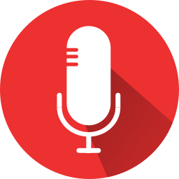
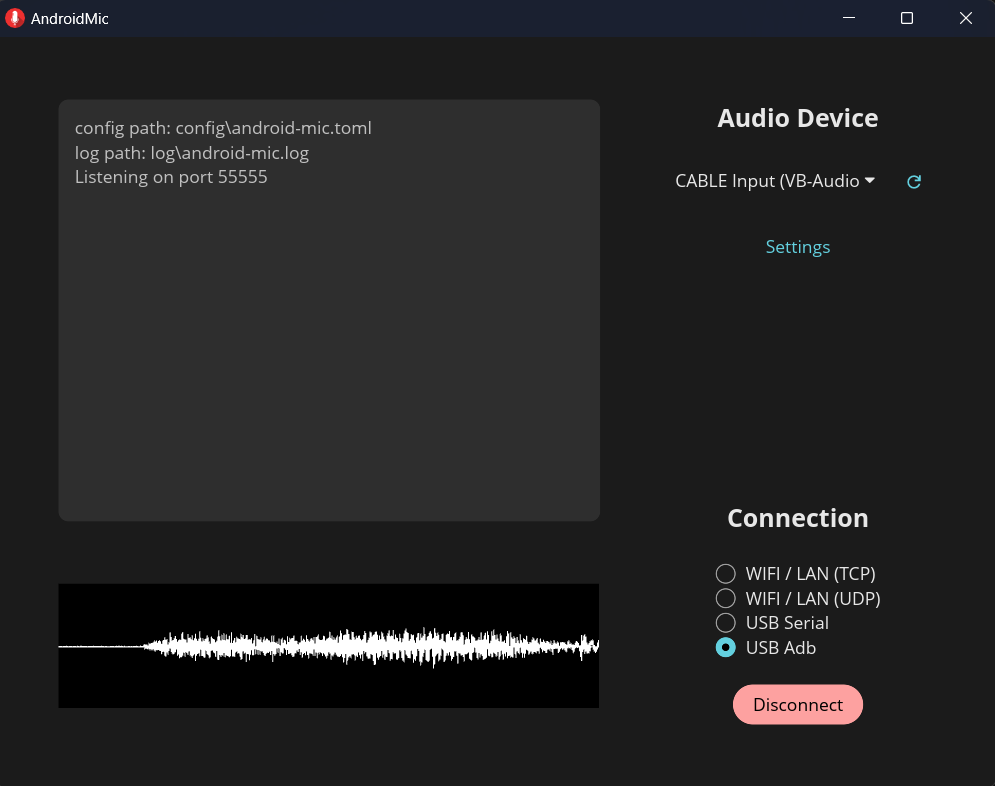
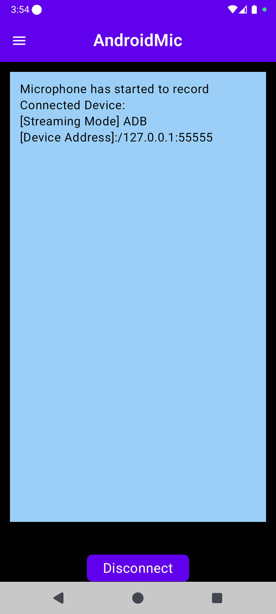

<p align="center">
  
  <h1 align="center" style="display: inline-block; margin-left: 12px; vertical-align: middle;">AndroidMic</h1>
</p>

<h3 align="center">Use your Android phone as a microphone for your PC</h3>

<!-- <a href="https://flathub.org/apps/io.github.teamclouday.AndroidMic"></a> -->
[](https://github.com/teamclouday/AndroidMic/releases/latest)
[](https://f-droid.org/packages/io.github.teamclouday.AndroidMic)
[](https://search.nixos.org/packages?channel=unstable&show=android-mic)

---

<p  style="text-align: center;">
  
  
</p>

## Features

- **Cross-platform**: Works on Linux, Windows, and macOS
- **Multiple connection options**: WiFi (TCP/UDP), USB Serial, and USB ADB
- **Audio processing**: Noise cancellation and audio wave visualization
- **Customizable audio settings**: Sample rate, channels, and bit depth

---

## ⚠️ Important Requirements

**This app requires a virtual audio cable device to work!**

AndroidMic streams audio from your phone to your PC, but your PC needs a way to recognize this audio stream as a microphone input. This is where virtual audio cables come in.

### Virtual Audio Cable Setup

**On Windows:**
- Install [Virtual Audio Cable (VAC)](https://vac.muzychenko.net/en/download.htm) or [VB Cable](https://vb-audio.com/Cable/) (both free options available)
- These tools create virtual audio devices on your system
- Once installed, you'll have a virtual output device (speaker/playback) and a virtual input device (microphone)
- AndroidMic plays audio to the virtual output, which is internally wired to the virtual input that your apps can use as a microphone

**On Linux:**
- Use PulseAudio or PipeWire to create virtual audio devices
- Example with PulseAudio:
  ```bash
  pactl load-module module-null-sink sink_name=virtual_mic
  pactl load-module module-remap-source master=virtual_mic.monitor source_name=virtual_mic_source
  ```

**On macOS:**
- Use [BlackHole](https://existential.audio/blackhole/) or similar virtual audio driver

---

## Setup Guide

### Step 1: Install Virtual Audio Cable

Follow the instructions above for your operating system to install a virtual audio cable solution. This step is **required** before proceeding.

### Step 2: PC Application Setup

1. **Download and install**
   - Get the latest release from the [releases page](https://github.com/teamclouday/AndroidMic/releases/latest)
   - **Nix / NixOS**: Run `nix run nixpkgs#android-mic` or add `pkgs.android-mic` to your configuration
   - Install and launch the app

   > **macOS users**: You may need to run this command to allow the app to run:
   > ```sh
   > xattr -c /Applications/AndroidMic.app
   > ```
   > See [this discussion](https://discussions.apple.com/thread/253714860?sortBy=best) for more details.

2. **Select output audio device**
   - Choose the **virtual output device** (e.g., "VB Cable Input" or "Virtual Audio Cable") from the dropdown
   - This is the playback device that's wired to your virtual microphone
   - Do NOT select your regular speakers or headphones
   - On Linux change channel count to "Mono" when you select PipeWire or PulseAudio

3. **Choose connection method**

   - **TCP/UDP (WiFi)**:
     - Connect your phone and PC to the same network
     - **Windows**: When the firewall prompt appears on first launch, click **Allow access**. Otherwise the PC can't receive connections from your phone. If you dismissed the prompt, allow AndroidMic in *Windows Security → Firewall & network protection → Allow an app through firewall*

   - **USB ADB**:
     - Install [Android Debug Bridge (ADB)](https://developer.android.com/tools/adb)
     - Enable USB debugging on your phone (Developer Options)
     - Connect phone via USB cable

   - **USB Serial**:
     - Connect phone via USB cable
     - Set phone's USB mode to "Charging only"
     - **Windows**:
       - Close Android Studio and ensure ADB process is not running
       - Your phone must use the WinUSB driver (required for all Android phones)
       - Use [Zadig](https://zadig.akeo.ie/) to replace the current USB driver with WinUSB if needed
       - On first connection attempt, the phone will switch to accessory mode - click Connect again to establish the connection
     - **Linux**: Configure [udev rules](https://github.com/libusb/libusb/wiki/FAQ#can-i-run-libusb-applications-on-linux-without-root-privilege) for USB permissions

4. **Configure audio settings** (Advanced)
   - Click to open advanced settings
   - Choose format supported by your virtual audio device
   - Common settings: 44.1kHz or 48kHz sample rate, mono channel, 16-bit or 24-bit depth

### Step 3: Android Application Setup

1. **Install the app**
   - Download the APK from [releases](https://github.com/teamclouday/AndroidMic/releases/latest) or [F-Droid](https://f-droid.org/packages/io.github.teamclouday.AndroidMic)
   - Install and open the app

2. **Configure settings**
   - Open the side drawer menu
   - Select the **same connection method** chosen on PC
   - Configure audio settings (sample rate, channels, bit depth) - these can be adjusted independently from PC settings

3. **Connect and start**
   - Grant required permissions:
     - **Microphone**: To access your phone's mic
     - **Notification**: To show recording status in background
     - **Nearby devices**: Required on Android 17 and above to connect to your PC. Approve it when prompted, or enable it in *Settings → Apps → AndroidMic → Permissions*
   - Start recording
   - Connect to PC:
     - **TCP/UDP**: Enter PC IP address and port (shown in PC app log)
     - **USB ADB**: Enter port number (shown in PC app log)
     - **USB Serial**: Allow accessory mode when prompted

---

## Using AndroidMic in Other Apps

After setup, the virtual microphone will appear in your system's audio input devices. Select it in any application:
- Discord, Teams, Zoom (voice chat)
- OBS, Streamlabs (streaming)
- Audacity, FL Studio (recording)
- Any other app that accepts microphone input

---

## On-Demand Capture

By default the phone keeps the microphone recording for the whole connection. With on-demand capture the PC watches the virtual-cable **capture** endpoint (the paired side of the playback cable AndroidMic writes to): when no application is actively recording from it, the PC tells the phone to stop capturing, and resumes it the moment an app opens the endpoint. This keeps the mic idle when nobody is listening, at the cost of a short resume delay.

### PC configuration

The settings live in the PC app config file (`AndroidMic.toml` under the app config directory) under the `[on_demand_capture]` section. Older config files without this section load the defaults below.

```toml
[on_demand_capture]
# Master switch. When false the PC never negotiates on-demand capture and keeps
# the legacy always-on behaviour. Default: true.
enabled = true

# Friendly-name substring of the virtual-cable capture endpoint to watch
# (e.g. "CABLE Output"). Matched case-insensitively as a substring, so a short
# hint can disambiguate several virtual cables. Empty means auto-detect the
# default VB-Cable output ("CABLE Output"). Default: "".
endpoint_id = ""
```

### How it works

1. **Handshake**: after a WiFi (TCP) or ADB connect, the PC sends a capture hello (protocol version, capabilities, nonce, initial demand); the phone replies with a hello ack. An unsupported protocol version, or a peer that never answers the hello, stays in legacy always-on mode.
2. **Control frames**: as the watched endpoint gains or loses active consumers, the PC sends capture control frames with the current demand state.
3. **Silence keepalive tail**: after demand goes false, the phone keeps sending generated silence for about 1.5 s so the PC playout does not have to rebuffer; only then does it stop the recorder.
4. **Degraded fail-open**: if the watcher cannot open or monitor the endpoint (endpoint not found, probe source unavailable, control channel breaks unexpectedly), the PC forces always-on capture end-to-end instead of cutting audio.
5. **Legacy peers**: an old phone that does not answer the hello, or an old PC without the feature, both fall back to always-on. A muted phone takes priority: it does not capture even when the PC demands audio.

### Recorder hold policies (debug-only)

When capture goes idle the phone can either release the recorder right away or keep it warm for some time, trading idle power against resume latency. Three experimental policies exist; **the shipped default is `immediate`**. The other two are debug-only: no UI, preference key, or release build exposes them.

| Policy | Idle behaviour | Resume on re-enable |
|---|---|---|
| `immediate` (default) | Releases the recorder after the existing ~1.5 s silence keepalive tail; the next demand edge cold-starts a fresh recorder. The baseline tail behaviour is unchanged. | Cold rebuild |
| `grace30s` | Keeps the recorder object retained for 30 s after the idle edge (the mic patch stays inactive during the window). | Within the window: restart the existing recorder; after expiry: cold rebuild |
| `always` | Holds the recorder and mic for the whole connection; idle keeps reading the mic but the gate drops audio locally and nothing is sent to the PC. | Warm, no rebuild |

**Why `immediate` is the default** — PR3 real-device measurements on a single MI9 (2026-11-21; evidence bundle `pr3_lock_policy_evidence/`, metrics in `pr38_metrics.md` / `SUMMARY_REPORT.md`):

1. **Lowest idle cost**: over a 10-minute idle, CPU time was immediate **4.180 s** < grace30s **6.505 s** ≪ always **37.754 s** (estimated ≈25.1 / 39.0 / 226.5 s per hour, 10 min ×6). Immediate and grace hold no `AudioIn` wakelock; always holds `Wake lock AudioIn` for 19.380 s.
2. **Acceptable resume latency, and better than grace**: after a 30 s idle, PC-received resume median was immediate **136.5 ms** (P90 196.3 ms) vs grace30s **491.35 ms** (max 1124.4 ms); always is **10.45 ms**, but pays for it by holding the mic the whole idle time.
3. **Smallest privacy surface**: immediate releases the mic on idle (idle audio track `active? false`, no wakelock); always keeps the track `active? true` for the whole idle period.

**Switching policy in debug builds**: write one of `immediate` / `grace30s` / `always` (case-insensitive, trimmed) to `<externalFilesDir>/lock_policy_override.txt` — typically `/storage/emulated/0/Android/data/io.github.teamclouday.AndroidMic.debug/files/lock_policy_override.txt`. A missing, empty, or unrecognized file falls back to `immediate`. The file is read once per audio-manager construction, i.e. re-read on every new connection; after switching, force-stop the app and reconnect. The reader and parser exist only in the debug source set.

**Release invisibility**: `src/main` holds only the stable strategy seam and the immediate implementation; `src/release` compiles an immediate-only factory, and all policy enum / controller / override code lives in `src/debug`. A string scan of the release APK dex finds zero debug-only symbols (`CaptureLockPolicy`, `RecorderHoldController`, `DebugHoldStrategy`, `LockPolicyOverride`, …); release builds never compile the experimental policies.

### Limitations

- **Transport**: the on-demand control channel only exists on WiFi (TCP) and USB ADB. USB Serial, UDP, and the removed Bluetooth path keep the legacy always-on behaviour.
- **Exclusive mode**: the watcher monitors shared WASAPI sessions on the capture endpoint. If another application holds the virtual-cable endpoint exclusively, or the endpoint exposes no shareable session, the watcher cannot see consumers and degrades to fail-open always-on.
- **Platform**: the probe source is Windows-only; on other platforms the feature degrades to always-on.
- **grace30s after a 30 s idle is a cold rebuild**: once the 30 s warm window has expired, resume goes through cold recorder init — measured median 491.35 ms, worse than immediate's 136.5 ms. The in-window warm reuse (199.2 ms, single sample) only applies to reconnects inside the same 30 s window of one connection. Recorder objects are never reused across connections; every reconnect cold-starts.
- **No auto-reconnect**: if the PC goes offline or restarts, the phone does not reconnect on its own; tap Connect manually (measured E2E C3).

---

## Troubleshooting

### Can't hear audio / No microphone detected
- Verify virtual audio cable is properly installed
- Ensure you selected the virtual **output** device in AndroidMic PC app
- Check that applications are using the virtual **input** device as microphone
- On Windows: Check that VAC/VB Cable devices are set as default in Sound Settings

### Windows Defender flags the app as malware
- Usually this is a false positive due to Windows Defender's ML algorithm
- Please [report to Microsoft](https://www.microsoft.com/en-us/wdsi/filesubmission) to help get it fixed

### USB connection not working
- **USB ADB**: Ensure USB debugging is enabled and ADB is installed
- **USB Serial**: May need [Zadig](https://zadig.akeo.ie/) to change USB driver to WinUSB
- **USB Serial (Linux)**: Configure udev rules for USB permissions

### Phone can't connect to PC
- **Android 37+**: Make sure the **Nearby devices** permission is granted to the app
- **Windows**: Make sure AndroidMic is allowed through the firewall (see [Step 2](#step-2-pc-application-setup))
- Confirm the phone and PC are on the same network

### Audio is choppy, stuttering or glitchy
- Increase the **jitter buffer** latency in the PC app settings. A larger buffer absorbs network delays at the cost of slightly higher latency. Raise it step by step until the audio is smooth
- The PC app logs a warning (`playout: ... underruns ...`) when the buffer runs dry, which is a sign you should increase it

### Audio quality issues
- Match audio settings between PC and Android app exactly
- Try different sample rates (44.1kHz or 48kHz)
- Turn on/off noise cancellation in the app

---

## Support & Contributing

- **Questions / Feature Requests / Bug Reports**: [Submit an issue](https://github.com/teamclouday/AndroidMic/issues)
- **Discussions**: [GitHub Discussions](https://github.com/teamclouday/AndroidMic/discussions)

## Project History

The PC app originally started as a WPF application written in C# for Windows only. Most features have been recreated in Rust (thanks to [@wiiznokes](https://github.com/wiiznokes)) for cross-platform support. The [WPF app branch](https://github.com/teamclouday/AndroidMic/tree/wpf-app-backup) is still available for reference.

**Note**: Bluetooth support was removed in favor of USB Serial connection, which provides better bandwidth.
